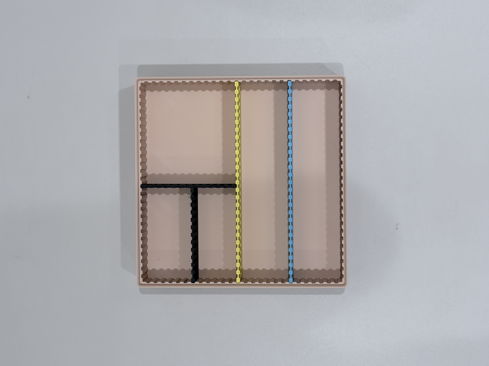

# Gridfinity 参数化收纳盒与分隔板

这是一个 Gridfinity 参数化收纳盒、分隔板和槽位规划工具的开源项目。

## 在线工具

打开 [Gridfinity 分隔板规划器](https://nexaio09.github.io/gridfinity-divider-planner/)，在槽位图上拖动即可生成分隔板，规划器会自动给出每块板所在槽位、需要的槽数与板长，并在空间足够时标注矩形隔间的尺寸。

板长计算公式：

```text
分隔板长度 = 插槽数量 × 6 + 5 mm
```

## 参数

- Gridfinity 标准单格：42 mm
- 盒体实际外形：格数 × 42 - 0.5 mm
- 单个凹槽：3 × 1.1 mm
- 凹槽内侧圆角：R0.5
- 分隔板长度：插槽数量 × 6 + 5 mm

## 槽位与隔间

盒体每条边的槽位（凹槽）数量：

```text
槽位数 = ((格数 × 42 - 9) / 3 - 1) / 2 = 7 × 格数 - 2
```

- 内腔开口 = 格数 × 42 - 9 mm（1 格 33 mm，2 格 75 mm）
- 槽宽 3 mm、槽深 1.1 mm、槽距 6 mm；首槽中心距内壁 4.5 mm，末槽中心从同一侧内壁量起为 6 × 槽位数 - 1.5 mm（2 格时 70.5 mm）
- 分隔板插在凹槽里，**一块板占掉 1 个槽位**；隔间大小按“剩下几个槽位”算

  例：2 格宽的一边有 12 个槽位，两块板插在第 4、8 槽，隔间是 `3 | 3 | 4`（3+1+3+1+4 = 12），不是 `4 | 4 | 4`

- 规划器里的“第 k 槽”= 从左（上）墙数起的第 k 个凹槽，和实物上数凹槽的顺序一致
- 板子的“槽数”= 这块板跨过的那段里**空着的槽位**数量（不是两端槽号之差）：

  ```text
  槽数 = 两端支撑序号之差 - 1     支撑：左/上墙 = 0，第 k 槽 = k，右/下墙 = N + 1
  ```

  例：2 格边 12 槽时——通长板 12 槽 / 77 mm；墙 → 第 4 槽 3 槽 / 23 mm；第 4 → 第 8 槽 3 槽 / 23 mm；第 8 槽 → 墙 4 槽 / 29 mm

相邻槽位之间剩余 0 槽，按公式计算为 5 mm，不会强制计为 1 槽。端点只能吸附到实际相交的边框或分隔板；移动支撑板时，与其相接的分支端点跟随移动。

## 模型展示

### 分隔板组合示例



### 收纳盒外观


## 文件结构

```text
hardware/fusion360/   Fusion 360 参数化源文件
hardware/step/        STEP 通用 CAD 文件
index.html            在线规划工具静态网页（GitHub Pages 入口）
tutorial/             使用教程 GIF
```

`.f3d` 文件保留 Fusion 360 参数化历史；STEP 文件用于其他 CAD 软件交换。

将仓库启用 GitHub Pages 后，根目录的 `index.html` 即为网页工具入口。

## 使用教程


## 打印与修改

请根据打印机、材料和实际打印结果调整公差。修改 Fusion 360 参数后，建议同时重新导出 STEP 和 STL 文件。

## 许可证

- CAD 硬件模型：见 [LICENSE-MODEL.md](LICENSE-MODEL.md)
- 网页工具代码：见 [LICENSE](LICENSE)
